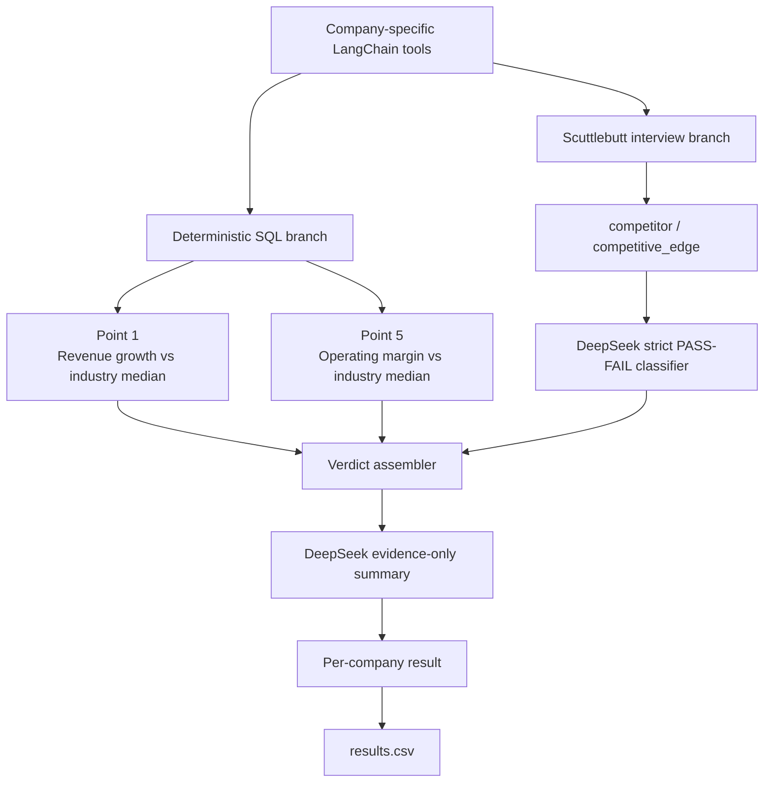

# FTEC5660 Homework 3: Fisher's 15-Point Investment Agent

Build a LangChain agent that researches a company with tools and applies the
framework from Philip Fisher's *Common Stocks and Uncommon Profits* (Part One,
Chapter 3 "What to buy: the fifteen points to look for in a common stock", and
Chapter 4 "What to buy: applying this to your own needs"). You choose 3 of
Fisher's 15 points and decide yourself what PASS means for each. For every
company your agent gives a PASS/FAIL verdict on your 3 points and a short
summary.

The companies are fictional, so the model cannot answer from memory. Unlike a
pile of reports, the evidence is spread over three sources, and your agent has
to go and get it with tools, the way Fisher's "scuttlebutt" method sends an
investor to talk to customers, competitors, suppliers and staff.

## Data and tools

`public_test/` has one folder per company. Your code receives four tools per
company (built by the provided code in `hw3.py`):

| Tool | What it gives you |
| --- | --- |
| `list_documents()` | the company's six documents and their dates |
| `read_document(name)` | one document: the 2025 letter to shareholders, four earnings calls (Q3 2025 to Q2 2026) and a news file (July 2025 to July 2026) |
| `sql_query(query)` | one read-only SQLite query on the company's database; at most 50 rows come back, so use `SUM`, `GROUP BY` and `WHERE` |
| `interview(role, topic)` | what one person says about the company; at most **10 interviews per company** |

The documents are what management says. Management's own claims (such as "we
have never cut research" or "our people are our greatest strength") are not
evidence on their own: check them against the database and the interviews.

**Database tables** (amounts in USD thousands; dates `YYYY-MM-DD`, months
`YYYY-MM`, quarters like `2025Q3`; the fiscal year is the calendar year):

| Table | Columns |
| --- | --- |
| `company` | name, industry |
| `industry_medians` | industry, revenue_growth_2y_pct, new_product_share_pct, new_product_sales_per_rd, operating_margin_pct (one row per industry; use the row for the company's own industry) |
| `orders` | order_id, order_date, product, customer, amount, note (about 3,000 to 4,000 orders from January 2023 to June 2026; revenue is the sum of order amounts) |
| `products` | product, launch_date |
| `monthly_costs` | month, cost_of_sales, selling_admin, research_development |
| `quarterly_cash` | quarter, operating_cash_flow, capex, cash_end |
| `capex_plan` | year, planned_capex (2026 to 2028) |
| `returns` | month, units_shipped, units_returned |
| `insider_trades` | trade_date, person, title, side (`buy` or `sell`), shares, price |

**Terms used in the data.**

| Term | Meaning |
| --- | --- |
| FY2025 | Fiscal year 2025. Here the fiscal year is the calendar year, so FY2025 is January to December 2025. |
| Quarter | Three months of the year: Q1 is January to March, Q2 April to June, Q3 July to September and Q4 October to December. The database writes `2025Q3`; the documents write "third quarter 2025". |
| Amounts | The database is in **USD thousands** (676,100 means US$676.1 million). The documents use USD millions. |
| Revenue | Money from sales: the sum of `amount` in `orders`. |
| Cost of sales | The cost of making the products that were sold. |
| Selling and admin | The cost of selling and of running the company (sales staff, offices, management). |
| R&D | Research and development spending, mainly on new products. |
| Operating margin | Operating profit as a share of revenue: (revenue − cost of sales − selling and admin − R&D) ÷ revenue. |
| Operating cash flow | Cash that the day-to-day business brings in during a quarter. |
| Cash at the end of a quarter | The cash the company holds on the last day of that quarter (`cash_end`). |
| Capex | Capital expenditure: spending on factories, machines and other long-term assets. `capex_plan` holds the planned capex for 2026 to 2028. |
| Return rate | Units returned ÷ units shipped, from the `returns` table. |
| Industry median | The middle value for companies in the same industry, from `industry_medians`. |
| Insider | A director or senior manager of the company. `insider_trades` lists the shares they bought (`buy`) or sold (`sell`). |
| Earnings call | A meeting each quarter where management presents the quarter's results to investors. Each call quotes that quarter's revenue. |

**Interviews.** Roles: `customer`, `current_employee`, `former_employee`,
`competitor`, `supplier`. Topics: `sales_team`, `working_conditions`,
`top_management`, `decision_making`, `competitive_edge`. Only some people know
about each topic; the others say they can't comment, and that answer still
uses up one interview.

| Topic | Who knows about it |
| --- | --- |
| `sales_team` | customer, competitor |
| `working_conditions` | current_employee, former_employee |
| `top_management` | former_employee, supplier |
| `decision_making` | supplier, customer |
| `competitive_edge` | competitor, customer |

People who know about a topic always agree with each other, so one good answer
is enough.

## Choose your 3 points and your rules

Pick any 3 of Fisher's 15 points and write them in `CHOSEN_POINTS` near the
top of `hw3.py`, e.g. `CHOSEN_POINTS = [1, 7, 15]`. The full questions are in
`FISHER_POINTS` in `hw3.py` and in the book.

| # | Fisher's point | Where the evidence is |
| --- | --- | --- |
| 1 | Market potential for sales growth | database |
| 2 | New products as current lines mature | database |
| 3 | Effective research and development | database |
| 4 | Above-average sales organization | interviews (`sales_team`) |
| 5 | Worthwhile profit margin | database |
| 6 | Maintaining or improving margins | database |
| 7 | Labour and personnel relations | interviews (`working_conditions`) |
| 8 | Executive relations | interviews (`top_management`) |
| 9 | Depth of management | interviews (`decision_making`) |
| 10 | Cost analysis and accounting controls | earnings calls, checked against the database |
| 11 | Advantage over competitors | interviews (`competitive_edge`) |
| 12 | Long-range outlook on profits | database |
| 13 | Growth without dilutive equity financing | database |
| 14 | Management talks freely about troubles | earnings calls, checked against the database |
| 15 | Management of unquestionable integrity | news file, checked against the database |

For each of your points, **you design the rule**: which evidence to use, what
to compute or whom to ask, and where the line between PASS and FAIL lies. PASS
means the company looks favourable on that point, as Fisher would see it.

We grade your verdicts against our own answer key. It uses one fixed rule per
point, which we do not publish, and the data never puts a company close to
the line of that rule, so a sensible reading of Fisher usually gives the same
answer. **Test your rules on the public answers**:
`public_test/ground_truth.json` gives the expected verdict on all 15 points
for each of the 20 public companies, and every point fails in 6 of them. If
your rule disagrees with the public answers, rethink it.

**Tip: calculate with tools, not in your head.** Do every sum, ratio and
comparison in SQL or Python, including the number of days between two dates
(SQLite's `julianday()` gives a date as a number of days).

## Student task

Fill in the three places in `hw3.py` marked `### YOUR CODE HERE`. You may add
imports, constants and helper functions above them, but do not change the
provided code below them:

- `CHOSEN_POINTS` lists your 3 points.
- `build_agent()` creates your model and anything else you need once.
- `analyze_companies(agent, companies)` receives
  `{company_folder: [list_documents, read_document, sql_query, interview]}`
  and returns, for every company,
  `{"points": {1: "PASS", 7: "FAIL", 15: "PASS"}, "summary": "..."}` (here with
  `CHOSEN_POINTS = [1, 7, 15]`).

Use the course techniques that fit your points: tool use for the database and
the interviews, planning which interviews to spend, routing each point to the
right source, prompt chaining, parallel calls, reflection to check your
answers, or a combination. Your code must read company data **only through
the four tools**; do not open `company.db` or `interviews.dat` yourself. Do
not hard-code folder names, company names or the public answers.

## Setup and public test

```bash
python3 -m venv .venv
source .venv/bin/activate
pip install -r requirements.txt
echo "DEEPSEEK_API_KEY=your_key_here" > .env
python3 hw3.py --data-folder public_test
```

Use your own DeepSeek API key (from https://platform.deepseek.com). The
required model is `deepseek-v4-flash`. We grade with our own key, so never put
a key in your code; `.env` must stay out of git.

The program creates `results.csv` with the columns `company`, `points`,
`points_correct`, `point_errors`, `interviews_used` and `summary`, and prints
the point score on your 3 points (the percentage after "balanced"). The point
score is the average of two shares: the share of truly passing verdicts that
you marked PASS and the share of truly failing verdicts that you marked FAIL.
For example, 90% and 60% give (90% + 60%) / 2 = 75%, and marking every point
PASS gives (100% + 0%) / 2 = 50%. Once `CHOSEN_POINTS` is set, the starter
runs before you add any API code (it returns no verdicts, so it scores 0%).

`public_test/ground_truth.json` gives the expected verdicts on all 15 points
for each public company. Grading uses a private set of about 20 unseen
companies with the same tools and the same answer key rules, but different
names and wording, and scores your 3 points only.

## Homework 3 solution:

### My 3 points and rules

I chose points 1, 5 and 11. The first two give the analysis a quantitative
foundation, while point 11 adds Fisher's qualitative, long-horizon view of
competitive position. This mix avoids asking the language model to perform
financial arithmetic and uses the interview tools only where qualitative
interpretation is genuinely useful.

#### Point 1: Market potential for sales growth

I chose this point because a long-term investment needs a business whose market
can support several years of expansion. The database contains full-year orders
from 2023 through 2025 and a comparable two-year growth benchmark for each
industry. PASS means that FY2025 revenue is at least the industry median
two-year growth rate above FY2023 revenue. The calculation uses
`SUM(amount)` over the `orders` table and compares the result with
`industry_medians.revenue_growth_2y_pct`. Fisher's emphasis on "sufficient market
potential" requires more than one strong period, so the rule deliberately uses a
multi-year comparison rather than a single quarter.

#### Point 5: Worthwhile profit margin

I chose this point because growth without an attractive operating margin can
destroy rather than create shareholder value. PASS means that FY2025 operating
margin is no lower than the median operating margin for the company's industry.
The rule computes:

```text
(FY2025 revenue - cost of sales - selling and admin - R&D)
/ FY2025 revenue
```

It uses `orders` for revenue, `monthly_costs` for the three cost categories, and
`industry_medians.operating_margin_pct` for the benchmark. Using the industry
median prevents the verdict from relying on an arbitrary absolute percentage
that would treat capital-intensive and asset-light industries identically.

#### Point 11: Advantage over competitors

I chose this point because it focuses on durable competitive position rather
than a single operational capability. Fisher asks about "other aspects of the
business, somewhat peculiar to the industry involved" that reveal whether a
company is outstanding relative to competitors. PASS requires an interview to
identify a concrete, company-specific advantage that rivals would struggle to
copy quickly, such as proprietary technology, a strong brand, switching costs,
scale, a structural cost advantage, or privileged supply or distribution access.
Merely being competent, competing mainly on price, or offering an easily copied
feature is FAIL. The evidence comes from
`interview("competitor", "competitive_edge")`; if that answer is unavailable, the
agent asks a customer about the same topic.

### Design



The agent routes each Fisher point to the source that matches the assignment.
Points 1 and 5 use fixed SQL queries, and SQLite returns both verdicts and the
underlying figures, so financial arithmetic never depends on the model. Point 11
uses one known-informative competitor interview and a constrained classifier
prompt. The classifier is instructed to PASS only concrete, hard-to-copy relative
advantages and to treat parity, price-only competition and easily imitated
features as FAIL. It returns a structured assessment containing whether a
relative advantage exists, whether that advantage is durable, a reason, and a
verbatim evidence quote. The code verifies that the quote occurs in the interview
and assigns PASS only when both model judgments are affirmative. A second
`deepseek-v4-flash` call writes a two-to-three-sentence summary from the three
verdicts and collected evidence only. Companies are processed concurrently with
a bounded semaphore, and each company has its own fallback so one failed API call
or tool invocation cannot prevent `results.csv` from being produced.

### Results

The final implementation was run three times on all 20 public companies with:

```bash
python3 hw3.py --data-folder public_test
```

| Run | Correct points | Balanced score | Runtime |
| --- | ---: | ---: | ---: |
| 1 | 60/60 | 100.0% | 17.576 s |
| 2 | 60/60 | 100.0% | 19.262 s |
| 3 | 60/60 | 100.0% | 18.669 s |

No company disagreed with the public answer key in the final runs, and no model
or tool call fell back to an error result. The stable score shows that the three
queries and classifier rules are reliable on the public set, although the
private set remains the more important test of generalization.

During validation, an earlier point 11 version produced seven false negatives.
In each case the interview said customers commonly return after trying a rival,
but the classifier required an additional named mechanism such as a patent or
switching cost. That was inconsistent with the assignment's statement that one
clear answer from an informed interviewee is sufficient. The final rubric treats
repeated customer return as evidence of revealed preference and stickiness
unless the interview explicitly describes the return as temporary or
promotion-driven. After this calibration, the agent still reasons from the
interview text; it does not map company names or public answers to verdicts.

## Task 2: Reflection on AI-Sycophancy and AI-Psychosis

In this reflection I use "AI-psychosis" as a non-clinical shorthand for a model
or user losing contact with the evidence: the system keeps producing confident
text after its reasoning has become detached from reality. AI-sycophancy is the
related tendency to agree with the user's framing, praise weak ideas, or present
the answer the user appears to want. Both problems are dangerous in investment
research because fluent language can make an unsupported conclusion feel like
analysis.

This homework made the risk concrete. When the first point 11 classifier
disagreed with the public answers, it was tempting to add more phrases until the
score reached 100%. That improved the public result, but it also moved the agent
away from the actual task. The agent was no longer becoming better at judging a
competitive advantage; it was becoming better at recognizing the public set.
This is a form of sycophancy toward the evaluation metric. The model and the
developer can both fall into it: the score agrees with the rule, the rule agrees
with the expected answers, and everyone stops asking whether the conclusion is
grounded in evidence.

The same temptation appears at the model level. A helpful-sounding assistant may
accept a company's management claims at face value, call every positive statement
a competitive advantage, or avoid saying that the evidence is insufficient. In
Fisher's framework this would be especially harmful. Management documents are
not independent evidence, and a polite interview answer is not automatically a
moat. A useful agent needs to distinguish a concrete relative advantage from
ordinary competence, a temporary price advantage, and a friendly but empty
compliment. It should also be allowed to reject an interview that does not
support the claim.

AI-psychosis in the evidence-grounded sense is the next step after sycophancy.
The model can start from a plausible label and then generate an increasingly
elaborate explanation that no longer matches the source. In an investment
context, fabricated switching costs, imagined management credibility, or a
confident summary built from missing evidence can all look convincing. The
danger is not limited to obvious factual errors. It also includes reasoning
loops in which each model output becomes the premise for the next one, until the
agent is arguing with itself instead of interrogating the company.

The final design tries to interrupt both failure modes with evidence discipline.
SQL returns the financial verdicts and their numbers, so the model does not do
arithmetic by memory. Point 11 uses the interview tool, requires a structured
judgment, and checks that the quoted evidence occurs in the interview. The
summary is instructed to use only the supplied verdicts and evidence. These
controls do not make the agent infallible, but they make unsupported claims
harder to disguise as complete reasoning.

The most important lesson is that evaluation is not the same as understanding.
Public answers are useful for calibration, but a perfect public score can still
hide overfitting. I would prefer a less certain agent that refuses to invent a
mechanism over a fluent agent that produces the expected label for the wrong
reason. In real use, I would add source citations, retries with evidence
validation, independent review for ambiguous cases, and an explicit abstention
state for insufficient evidence. Those safeguards matter more than an extra
percentage point on a visible test set.

AI can be genuinely useful in this process because it can read many sources,
organize competing signals, and challenge a preliminary judgment. It becomes
dangerous when it is rewarded for sounding certain rather than being correct, or
when users treat a polished answer as a substitute for evidence. The goal should
not be an agent that agrees with the user or the answer key. The goal should be
an agent whose conclusions can be traced back to the company's data, interviews,
and clearly stated Fisher rules.
